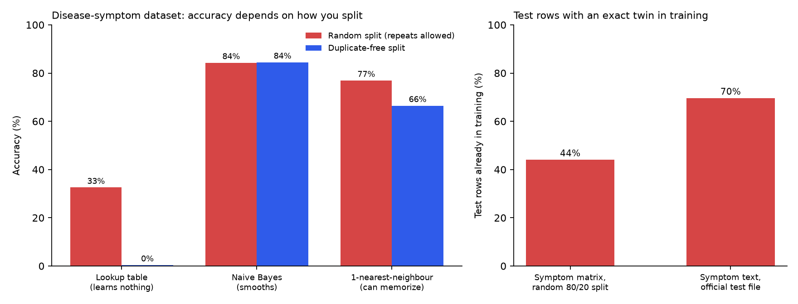

# leakcheck

[](https://github.com/Saagnik-Mondal/leakcheck/actions/workflows/ci.yml)

**Is that accuracy real?** `leakcheck` audits a labelled dataset for duplicate rows, conflicting labels and train/test leakage, and measures how much of a reported accuracy could come from memory instead of learning.

I used it on two public symptom-to-disease datasets from the Hugging Face Hub, the kind people use to train diagnosis models. Both have problems that a standard random split hides.



## What I found

**Dataset 1: [`dhivyeshrk/Disease-Symptom-Extensive-Clean`](https://huggingface.co/datasets/dhivyeshrk/Disease-Symptom-Extensive-Clean)** (246,945 rows, 377 symptoms, 773 diseases). Full report: [`reports/disease_symptom_matrix.md`](reports/disease_symptom_matrix.md).

| Check | Result |
|---|---:|
| Exact duplicate rows | 23.2% |
| Rows whose symptoms also appear with a different disease | 16.1% |
| Best accuracy any model could reach on the data as given | 91.6% |
| Test rows with an exact twin in training (random 80/20 split) | 44.0% |
| Lookup table that learns nothing: random split vs duplicate-free split | 32.6% vs 0.4% |
| 1-nearest-neighbour (a model that can memorize): random vs duplicate-free | 77.0% vs 66.5% |
| Naive Bayes: random vs duplicate-free | 84.3% vs 84.5% |
| Test rows with no exact twin whose nearest training row differs by one symptom | 99.0% |

**Dataset 2: [`dux-tecblic/symptom-disease-dataset`](https://huggingface.co/datasets/dux-tecblic/symptom-disease-dataset)** (symptom descriptions in text, with an official train and test file). Full report: [`reports/symptom_text_official_split.md`](reports/symptom_text_official_split.md).

| Check | Result |
|---|---:|
| Official test rows that also appear in the official train file | **69.6%** (980 of 1,409), all with the same label |
| Duplicate rows inside the train file | 64.6% |
| A lookup table that learns nothing, scored on a random split of train | 71.2% |

### What this means

- **A random split can overstate accuracy.** On dataset 1, 1-nearest-neighbour loses 10.5 points once identical rows are kept out of the test set. On dataset 2, more than two thirds of the official test file is already in the training file, so a high score there says little.
- **Not every model is fooled.** Naive Bayes scored the same on both splits for dataset 1, because it smooths over the data instead of memorizing it. Duplicates mainly hurt models that can memorize: nearest neighbour, trees, neural networks.
- **Removing exact duplicates is not enough.** For 99% of the test rows with no exact twin, the nearest training row differs by a single symptom. The data is made of near-copies, so a "duplicate-free" split can still leak.
- **Identical symptoms, different diseases.** 16.1% of rows in dataset 1 share their symptoms with a differently-labelled row, so no model can exceed 91.6% on that data. A reported accuracy above that ceiling on the full data would be a red flag.

These are facts about the files as published, measured by the code in this repo. They are a common problem in public datasets and not a criticism of the people who shared them.

## What it checks

1. **Duplicates and conflicts:** exact duplicate rows, feature vectors that appear with more than one label, and the accuracy ceiling those conflicts imply.
2. **Split leakage:** over repeated random splits, the share of test rows whose exact features already appear in training.
3. **Memorization test:** accuracy on a random split vs a duplicate-free split (identical rows kept together) for a lookup table, a naive Bayes model and a 1-nearest-neighbour model. A big drop means the random-split score was partly memory.
4. **Near-duplicates:** for test rows with no exact twin, how many features differ from the nearest training row (binary features).
5. **Single-feature scan:** how well one feature alone predicts the label. An unusually strong one often means an ID, a post-outcome measurement or a copy of the label.
6. **Official splits:** how much of a provided test file already appears in the provided train file (`--test`).

## Use it

```bash
pip install git+https://github.com/Saagnik-Mondal/leakcheck.git

leakcheck data.csv --target label                       # full report
leakcheck train.csv --target label --test test.csv      # also check an official split
leakcheck data.csv --target label --out report.md --json report.json
```

```python
import pandas as pd
from leakcheck import audit
from leakcheck.report import to_markdown

result = audit(pd.read_csv("data.csv"), target="label")
print(result.risk, result.split_leak_rate_pct)
print(to_markdown(result))
```

Features can be numeric, boolean or categorical. Free-text features get the duplicate and split checks, and the model-based ones are skipped.

## Does it cry wolf?

A leakage detector is only useful if it stays quiet on clean data. Audits of well-known datasets that ship with scikit-learn ([`reports/clean_baselines.md`](reports/clean_baselines.md)):

| Dataset | Rows | Exact duplicate rows | Test rows with an exact twin | Verdict |
|---|---:|---:|---:|---|
| Iris | 150 | 1 (0.7%) | 0.8% | low |
| Wine | 178 | 0 | 0.0% | low |
| Breast cancer (Wisconsin) | 569 | 0 | 0.0% | low |
| Digits (8x8 images) | 1,797 | 0 | 0.0% | low |

The first version of the risk rule rated Iris and Wine "moderate". On 150-row datasets the random and duplicate-free splits differ by noise, and a gap of 3 points was enough to trigger the rating. A model's drop now only counts when at least 1% of test rows have an exact twin (see the [changelog](CHANGELOG.md)).

## Fixing it: `safe_split`

```python
from leakcheck import safe_split

split = safe_split(df, target="label", test_size=0.2, near=0)
train, test = df.iloc[split.train], df.iloc[split.test]
```

`near=0` keeps every copy of an identical row on the same side. `near=k` also keeps together rows that differ in at most `k` features (binary features, up to 30,000 distinct rows). If near-duplicates chain most of the data into one cluster, it warns instead of returning a leaky split.

**A limit worth knowing.** On a 30,000-row sample of dataset 1, grouping rows that differ by one symptom puts **39.9% of the rows into a single cluster**. That cluster cannot be split without leaking, so it stays in training, and the test set is drawn from the remaining, easier rows. Naive Bayes then scores 80.1% instead of 68.3%, which says nothing about the model and everything about the test set. For this data no representative leak-free split exists at distance 1, so the honest approach is to report the exact-copy split and state the limitation. Details: [`reports/near_duplicate_split.md`](reports/near_duplicate_split.md). (A sample has fewer exact twins than the full file, 10.2% against 44.0%, so effects here are smaller than on the full data.)

## Reproduce the findings

```bash
uv sync --extra dev
uv run python analysis/audit_public.py   # downloads about 190 MB, then writes reports/ (about 75 seconds)
```

## How it works, and what it cannot tell you

- Row identity is a 64-bit hash of a row's feature values (the label is excluded), so two rows match only if every feature matches.
- The "duplicate-free split" keeps identical rows together, so no test row has an exact twin in training. It does not remove near-duplicates; section 4 of each report measures those separately.
- The models are deliberately simple so the audit runs on a laptop in about a minute. They show how much of a score is memory, not what the best possible model would score.
- Metrics, splits and the ceiling calculation are written in numpy and pandas, and tested against synthetic datasets with known answers (26 tests).
- It detects overlap inside the data you give it. It cannot tell whether your data overlaps with a different dataset, or whether a model was trained on your test set.

## License

MIT. See [LICENSE](LICENSE). The audited datasets are not included; the script downloads them from the Hugging Face Hub under their own licenses.
